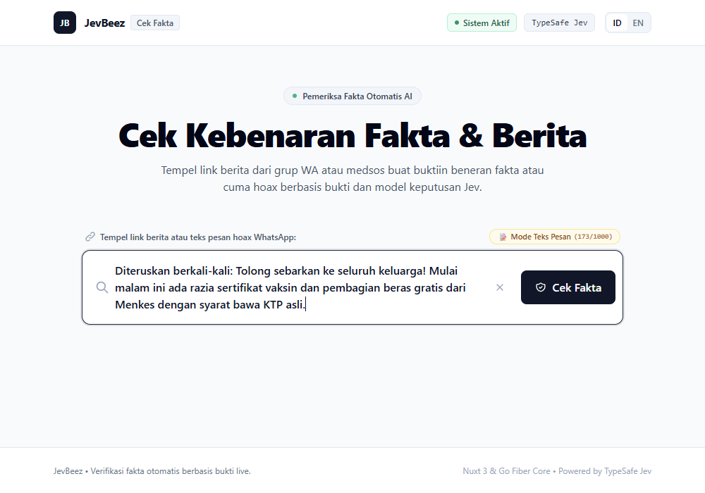
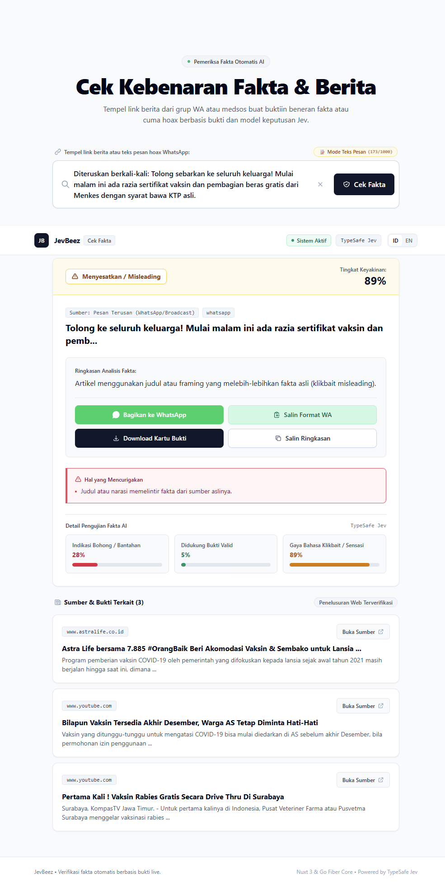

<div align="center">

# 🛡️ JevBeez

**Automated Evidence-Grounded Fact-Checking & Cyber Threat Detection Engine**

*Combatting digital disinformation, viral WhatsApp hoaxes, phishing, and malware threats using calibrated System One probabilistic decision models (TypeSafe Jev) and real-time empirical web evidence grounding.*

[](https://golang.org)
[](https://nuxt.com)
[](https://vuejs.org)
[](https://tailwindcss.com)
[](https://redis.io)
[](https://www.docker.com)
[](LICENSE)

</div>

---

## 📸 User Interface

### 1. Smart Fact-Check & Threat Intelligence Workbench
Modern editorial interface featuring zero-friction smart input detection (auto-switches between URL link and raw WhatsApp broadcast message) with live system status indicator:


### 2. Auto-Detect WhatsApp Broadcast Text Mode
Pasting raw hoax messages automatically toggles text mode, enforces character limits (up to 1,000 runes), and prepares the broadcast claim for RE2 linear-time sanitization:



### 3. Analysis Dossier & Multi-Source Evidence Grounding
Displays transparent verification verdicts, calibrated confidence scores, probabilistic decision vectors (TypeSafe Jev), cited web sources, instant 1-click WhatsApp debunk generator, and downloadable client-side evidence card:



---

## 🌟 Overview

The proliferation of online disinformation, viral WhatsApp broadcasts, fake news, deceptive scams, and credential-harvesting phishing campaigns often spreads faster than manual debunking can keep up. Furthermore, standard Large Language Models (LLMs) frequently suffer from **hallucinations**, presenting fabricated statements with false confidence.

**JevBeez** provides a robust, enterprise-grade fact-checking and cyber threat mitigation platform built on a defense-in-depth hybrid architecture:
1. **Smart Unified Input & Broadcast Cleaner**: Automatically differentiates between web links and viral text messages. Raw broadcasts are cleaned using pure Go RE2 linear regex to strip WhatsApp noise, fake authority hooks, forwarding tags, and phone numbers without LLM costs.
2. **Multi-Platform Scraper & Content Extractor**: Securely parses article claims and social media URLs (Twitter/X, TikTok, YouTube, Instagram, Threads, Facebook) using SSRF-safe scrapers and OEMBED protocols.
3. **Safe Shortener Resolver**: Unrolls obfuscated redirect chains (`s.id`, `bit.ly`, `tinyurl.com`, `link.id`, etc.) via lightweight HTTP header hops with fallback safe GET without downloading untrusted payloads.
4. **Zero-Contact Threat Heuristics (<20ms)**: Instantly detects brand impersonation, boundary-token spoofing, homoglyphs, raw IP hosts, high-risk TLDs, and executable dropper files (`.apk`, `.exe`) without contacting the malicious target server.
5. **Sandboxed Deep Dive Inspector**: On-demand isolated inspection streaming a maximum of 100KB with strict 3-second timeouts to identify credential-theft forms (PIN, OTP, CVV, passwords) and external data exfiltration.
6. **Multi-Source Evidence Grounding**: Performs live internet fact-finding across authoritative news outlets and independent fact-checking databases via Tavily & Firecrawl.
7. **System One Decision Engine (TypeSafe Jev)**: Evaluates claim validity through mathematically calibrated probabilities rather than unconstrained generative text.
8. **Permanent Archive Permalinks & Share Tools**: Instant 30-day permalink caching (`/c/:hash`), 1-click WhatsApp debunk messages, and 100% client-side HTML5 Canvas evidence card generation.

---

## ✨ Core Features

- 📝 **Smart Unified Input (Auto-Detect Link vs Text)**:
  - Automatically identifies whether user pasted a web URL (`[🔗 Mode Tautan]`) or a raw viral broadcast message (`[📝 Mode Teks Pesan]`).
  - Seamless zero-friction workflow without manual tab toggles.
- 🧹 **Pure Go WhatsApp Broadcast Cleaner (RE2 Linear Time)**:
  - Strips forwarding tags (*"Forwarded as received"*, *"Diteruskan"*), fake authority hooks (*"Info dari dokter RSPAD/IDI"*), viral exhortations (*"Sebarkan ke 10 grup"*), phone numbers, and formatting noise.
  - Formulates concise search queries (< 100 runes) snapped to clean word boundaries.
  - Guaranteed linear-time execution: **0% ReDoS vulnerability** and zero network I/O (**Zero SSRF risk** in Text Mode).
- 💰 **Zero-Waste Token & Cost Architecture**:
  - **Redis SHA-256 Deduplication**: Identical claims return cached results instantly (**0 Tavily tokens, 0 Jev tokens**).
  - **Zero-Evidence Short-Circuit**: If live search returns 0 corroborating news sources, the system returns `UNVERIFIED` immediately without calling TypeSafe Jev (**0 Jev tokens spent**).
  - **Lean Payload Trimming**: Capped queries (max 100 runes) and snippets (max 200 runes per top 3 sources) keep context size minimal.
- ⚖️ **Calibrated Probabilistic Decision Modeling (TypeSafe Jev)**: Generates 3 independent quantitative metrics:
  - `supported_by_evidence`: Probability that the claim is substantiated by credible web evidence.
  - `contradicted_by_evidence`: Probability that the claim is refuted by verified reporting.
  - `sensational_framing`: Degree of clickbait, emotive exaggeration, or sensationalist framing.
- 🎯 **Comprehensive Verdict Classifications**:
  - **Factual Verifications**:
    - `VALID`: Factually accurate and corroborated by authoritative sources.
    - `HOAX`: Debunked claim or proven falsehood.
    - `MISLEADING`: Out-of-context, unverified, or manipulated narrative.
    - `UNVERIFIED`: Insufficient empirical evidence to draw a definitive conclusion.
  - **Cyber Threat Verifications**:
    - `PHISHING`: Fake login portals or credential-harvesting websites.
    - `MALWARE`: Malicious executables or deceptive APK dropper links.
    - `SCAM`: Fraudulent schemes, fake lotteries, cloaked ad redirects, or impersonation campaigns.
  - **Commercial Classifications**:
    - `ADS`: Commercial marketplace or paid advertisement link (e.g., eBay, Amazon, Shopee, Tokopedia) unrolled from ad-tracking networks; classified as commercial traffic to prevent false hoax claims.
- 🎣 **Zero-Contact Threat Detection Engine**:
  - Protects users immediately by terminating before contacting rogue servers when fatal anomalies are discovered.
  - Boundary-aware brand profile matching preventing false positives on legitimate domains (`lenovo.com`, `cambridge.org`).
  - Covers Indonesian & global institutions: BCA, Mandiri, BRI, BNI, DANA, OVO, Shopee, Tokopedia, Gojek, Grab, etc.
- 🔗 **Safe Shortener Unroller**:
  - Traces up to 5 redirection hops with strict SSRF loopback protection and HTTP 405/501 fallback.
- 🧩 **Ad & Wrapper Unpacker**:
  - Unwraps nested redirector parameters (`adurl`, `to`, `u`, `q`, etc.) up to 3 levels with zero network contact, decoding up to double URL-encoded payloads.
  - Flags obfuscated hexadecimal subdomains and empty cloaked landing pages as `SCAM`, and tags links resolving to known marketplaces (eBay, Amazon, Shopee, Tokopedia, etc.) as `ADS`.
- 🧪 **Sandboxed Deep Dive Content Audit**:
  - Users can optionally trigger deep content inspection to verify `<form>` input targets and Telegram bot exfiltration webhooks in a constrained sandbox.
- 💬 **1-Click WhatsApp Debunk Generator**:
  - Generates ready-to-paste WhatsApp messages with bold headers (`*bold*`), concise factual summaries, cited references, and permanent archive links.
- 🖼️ **Client-Side HTML5 Canvas Evidence Card**:
  - One-click `.png` evidence card generator rendered 100% inside the user's browser with **zero server CPU overhead, zero external dependencies, and zero XSS vulnerability**.
- 🗄️ **30-Day Permanent Archive Permalinks (`/c/:hash`)**:
  - Generates shareable, persistent audit links backed by Redis `SET NX` caching with automated 30-day TTL.
- ⏳ **Glass-Box Reasoning Timeline (Progress Stepper)**:
  - Interactive 4-phase visual progress indicator during verification:
    1. Analyzing input and dissecting claims...
    2. Grounding live references across credible press...
    3. Probabilistic evaluation via TypeSafe Jev...
    4. Compiling verification summary...
- 🛡️ **Edge Honeypot & Scanner Trap**:
  - Edge Nitro middleware intercepts automated vulnerability scanners (`/.env`, `/.git`, `/wp-admin`, etc.) with HTTP 403 before reaching application handlers.
  - Core Go service applies automated 24-hour IP bans for persistent exploit probes.

---

## 🏛️ System Architecture

```
                                  +-----------------------+
                                  |     Client / User     |
                                  |   (Browser / Mobile)  |
                                  +-----------+-----------+
                                              |
                                              | HTTPS
                                              v
                              +-------------------------------+
                              |    Nuxt 4 Frontend (SSR)      |
                              |   - Smart Input Detection     |
                              |   - Edge Honeypot Trap        |
                              |   - Client HTML5 Canvas Card  |
                              |   - WhatsApp Debunk Builder   |
                              +---------------+---------------+
                                              |
                                              | Internal Network (Proxy)
                                              v
                              +-------------------------------+
                              |      Go Fiber API Service     |
                              |   (Core Engine, Port 8080)    |
                              +---------------+---------------+
                                  |           |           |
            +---------------------+           |           +---------------------+
            | Redis Cache                     |                                 |
            v (TTL Caching & Permalinks)      v (Live Grounding)                v (Probabilistic Evaluation)
   +-----------------+            +------------------------+            +-----------------------+
   |   Redis Store   |            | Search & Scraping Core |            |   TypeSafe Jev AI     |
   |   (Port 6379)   |            |  - Tavily Search API   |            | System One Evaluator  |
   | - Deduplication |            |  - Firecrawl Engine    |            +-----------------------+
   | - 30d Permalinks|            |  - Go RE2 Text Cleaner |
   | - 24h IP Bans   |            |  - SSRF Safe Scraper   |
   | - Rate Limits   |            |  - Heuristic Engine    |
   +-----------------+            |  - Shortener Resolver  |
                                  |  - Ad Wrapper Unpacker |
                                  +------------------------+
```

---

## 🛠️ Tech Stack

| Layer | Component / Library | Purpose |
|---|---|---|
| **Frontend** | Nuxt 4 (Vue 3, TypeScript) | Server-Side Rendering (SSR), high performance & responsive UI |
| **Styling** | Tailwind CSS v3 | Editorial typography and adaptive threat banner system |
| **Backend Core** | Go 1.23, Fiber v2 | High-throughput, memory-efficient micro-service architecture |
| **Text Processing**| Go standard `regexp` (RE2) | Anti-ReDoS linear time broadcast cleaning & query extraction |
| **Decision Model** | TypeSafe Jev AI | Non-hallucinatory System One calibrated probabilistic evaluation |
| **Search & Evidence** | Tavily Search & Firecrawl | Primary source discovery and live multi-source web extraction |
| **Heuristics & Sandbox**| Go standard `net/http` & `net/url` | Zero-contact heuristic analysis, offline ad wrapper unrolling, & sandboxed form audit |
| **Card Generation**| HTML5 Canvas API | 100% client-side graphic card rendering without headless browsers |
| **Caching Layer** | Redis 7 Alpine | Deduplication, permalinks (`SET NX`), IP bans, and rate limiters |
| **Containerization** | Docker & Docker Compose | Multi-container reproducible deployment |

---

## 🚀 Getting Started

### Prerequisites
- [Docker](https://www.docker.com/) & Docker Compose (v2.x or newer)
- Or for local development without Docker:
  - [Node.js](https://nodejs.org/) (>= 22.x) & [Bun](https://bun.sh/)
  - [Go](https://golang.org/) (>= 1.23)
  - [Redis Server](https://redis.io/) (>= 7.x)

### 1. Clone Repository
```bash
git clone https://github.com/Scr34m1nG/JevBeez.git
cd JevBeez
```

### 2. Configure Environment Variables
Copy the configuration template and fill in the required API keys:
```bash
cp .env.example .env
```

Set the values in your `.env` file:
```env
PORT=8080
CORS_ORIGIN=*
REDIS_ADDR=redis:6379
REDIS_PASSWORD=

# External Service API Keys
TYPESAFE_API_KEY=your_typesafe_api_key_here
TAVILY_API_KEY=your_tavily_api_key_here
FIRECRAWL_API_KEY=your_firecrawl_api_key_here

API_INTERNAL_URL=http://api:8080
```

> **Security Note:** Never commit your production `.env` file or expose private API credentials to a public repository.

---

### 3. Run with Docker Compose (Recommended)

Start the entire system with one command:
```bash
docker compose up --build -d
```

Services will be accessible at:
- **Web Interface:** `http://localhost:3000`
- **Backend API:** `http://localhost:8080`
- **Redis Cache:** `127.0.0.1:6379`

To stop the services:
```bash
docker compose down
```

---

### 4. Local Development (Without Docker)

**Step A: Start Redis**
```bash
docker run -d --name jevbeez-redis -p 6379:6379 redis:7-alpine
```

**Step B: Start Backend API (Go)**
```bash
cd apps/api
go run cmd/server/main.go
```

**Step C: Start Frontend (Nuxt)**
```bash
cd apps/web
bun install
bun run dev
```
Open your browser at `http://localhost:3000`.

---

## 📡 API Documentation

### 1. `GET /health`
Verifies backend service operational health.

**Response (`200 OK`):**
```json
{
  "service": "jevbeez-api",
  "status": "ok"
}
```

---

### 2. `POST /api/v1/analyze`
Analyzes a URL or a WhatsApp broadcast message for factual verification or cyber threats.

**Request Headers:**
- `Content-Type: application/json`

#### Option A: URL Analysis Request
```json
{
  "url": "https://example.com/article-or-link",
  "deep_dive": false
}
```

#### Option B: Broadcast Text Analysis Request
```json
{
  "text": "Diteruskan berkali-kali: Info dari dokter RSPAD bagi-bagi obat gratis klik link ini..."
}
```

| Parameter | Type | Required | Description |
|---|---|---|---|
| `url` | `string` | Optional* | Target web or social media URL to analyze |
| `text` | `string` | Optional* | Raw broadcast text or claim message (min 25 runes, max 1000 runes) |
| `deep_dive` | `boolean` | No | When `true`, executes sandboxed form & DOM inspection (Default: `false`) |

*\*Either `url` or `text` must be provided.*

#### Example Response: Standard Fact-Checking (`200 OK`)
```json
{
  "verdict": "VALID",
  "confidence": 88,
  "judgments": {
    "supported_by_evidence": 0.88,
    "contradicted_by_evidence": 0.05,
    "sensational_framing": 0.08
  },
  "article_title": "Verified News Headline",
  "article_url": "https://example.com/article-or-link",
  "source_domain": "example.com",
  "summary": "The claim is substantiated by multiple credible news reports and factual corroboration.",
  "red_flags": [],
  "evidences": [
    {
      "source": "reuters.com",
      "title": "Official Report on the Event",
      "snippet": "Corroborating statement from official representatives...",
      "url": "https://www.reuters.com/article/..."
    }
  ],
  "share_hash": "a1b2c3d4e5f60718293a4b5c6d7e8f90",
  "is_cached": false,
  "is_text_mode": false,
  "is_threat": false
}
```

#### Example Response: Threat / Phishing Detection (`200 OK`)
```json
{
  "verdict": "PHISHING",
  "confidence": 92,
  "judgments": {
    "supported_by_evidence": 0,
    "contradicted_by_evidence": 0,
    "sensational_framing": 0
  },
  "article_title": "Security Threat Warning: Phishing / Fake Site",
  "article_url": "https://bca.co.id.login-promo.xyz/auth",
  "source_domain": "login-promo.xyz",
  "summary": "This link exhibits high-risk cyber threat characteristics matching phishing campaigns. Do not enter credentials or OTP codes.",
  "red_flags": [
    "High-risk top level domain (.xyz) frequently associated with malicious campaigns",
    "Subdomain spoofing impersonating official brand 'bca'"
  ],
  "evidences": [],
  "share_hash": "8f7e6d5c4b3a2109fedcba9876543210",
  "is_cached": false,
  "is_threat": true,
  "threat_type": "PHISHING",
  "threat_reasons": [
    "Subdomain spoofing targeting brand 'bca'",
    "High-risk top level domain (.xyz)"
  ],
  "target_brand": "bca",
  "resolved_url": "https://bca.co.id.login-promo.xyz/auth",
  "form_threats": [],
  "is_deep_dive": false
}
```

#### Example Response: Paid Advertisement / Marketplace Link (`200 OK`)
```json
{
  "verdict": "ADS",
  "confidence": 95,
  "judgments": {
    "supported_by_evidence": 0,
    "contradicted_by_evidence": 0,
    "sensational_framing": 0
  },
  "article_title": "Iklan Berbayar: www.ebay.com",
  "article_url": "https://www.google.com/pagead/aclk?sa=L&adurl=https%3A%2F%2Fwww.ebay.com%2Fitm%2F123",
  "source_domain": "www.ebay.com",
  "summary": "Tautan ini adalah iklan berbayar yang mengarah ke marketplace www.ebay.com. Karena bukan klaim berita, JevBeez tidak memverifikasi faktanya. Pastikan transaksi hanya dilakukan di dalam platform resmi.",
  "red_flags": [
    "Tautan iklan berbayar, bukan artikel berita."
  ],
  "evidences": [],
  "share_hash": "3e2d1c0b9a8f7e6d5c4b3a2109876543",
  "is_cached": false,
  "is_threat": false,
  "resolved_url": "https://www.ebay.com/itm/123",
  "redirect_hops": [
    "https://www.ebay.com/itm/123"
  ]
}
```

#### Example Response: Cloaked Ad Scam (`200 OK`)
```json
{
  "verdict": "SCAM",
  "confidence": 82,
  "judgments": {
    "supported_by_evidence": 0,
    "contradicted_by_evidence": 0,
    "sensational_framing": 0
  },
  "article_title": "Peringatan Waspada: Indikasi Situs Penipuan (Scam)",
  "article_url": "https://www.google.com/pagead/aclk?sa=L&adurl=https%3A%2F%2Fvk.com%2Faway.php%3Fto%3Dhttps%3A%2F%2Fbaf9105c4584fac832929f959728944d.cavemin.com%2Fsttodm%2F",
  "source_domain": "cavemin.com",
  "summary": "Tautan ini terindikasi kuat sebagai situs penipuan dengan rekayasa sosial, iming-iming hadiah palsu, atau pemerasan digital.",
  "red_flags": [
    "Subdomain berupa deretan karakter heksadesimal acak, pola umum penyamaran tautan penipuan agar lolos dari daftar blokir."
  ],
  "evidences": [],
  "share_hash": "c7b6a594837261504f3e2d1c0b9a8f7e",
  "is_cached": false,
  "is_threat": true,
  "threat_type": "SCAM",
  "threat_reasons": [
    "Subdomain berupa deretan karakter heksadesimal acak, pola umum penyamaran tautan penipuan agar lolos dari daftar blokir."
  ],
  "resolved_url": "https://baf9105c4584fac832929f959728944d.cavemin.com/sttodm/",
  "redirect_hops": [
    "https://vk.com/away.php?to=https://baf9105c4584fac832929f959728944d.cavemin.com/sttodm/",
    "https://baf9105c4584fac832929f959728944d.cavemin.com/sttodm/"
  ]
}
```

---

### 3. `GET /api/check/:hash`
Retrieves a cached 30-day verification result using its SHA-256 permalink hash.

**Parameters:**
- `hash` (Path, required): Hexadecimal verification hash (8 to 64 characters).

**Response (`200 OK`):** Returns the cached `VerificationResult` object with `"is_cached": true`.  
**Response (`404 Not Found`):** When hash is expired or non-existent.

---

## 🔒 Security & Privacy Policy

JevBeez is engineered with strict **Zero-Risk** and **Privacy-by-Design** principles:
1. **SSRF (Server-Side Request Forgery) Mitigation**:
   - Strict protocol enforcement (only `http` and `https` permitted).
   - Pre-flight DNS resolution before fetching to block all RFC 1918 private IP subnets, loopback (`127.0.0.0/8`), link-local (`169.254.0.0/16`), and internal Docker virtual networks.
   - **Zero SSRF in Text Mode**: Text mode runs 100% in-memory; internal IPs or links mentioned in broadcast text are never scraped or connected.
2. **ReDoS Defense**:
   - Broadcast text cleaner uses Go's standard `regexp` engine (RE2), guaranteeing linear time execution $O(n)$ with zero backtracking overhead.
3. **Stored XSS Prevention**:
   - Frontend Nuxt templates strictly use safe text interpolation `{{ ... }}` and zero `v-html` for dynamic user content and permalink results.
   - Canvas card generation rasterizes text directly with HTML tags stripped.
4. **Data Privacy**:
   - **No Personally Identifiable Information (PII) is recorded or stored**.
   - Analysis evaluates public web metadata, claims, and verified news sources only.
5. **Hardened HTTP Headers & Honeypot**:
   - Edge Nitro honeypot immediately drops scanner paths (`/.env`, `/.git`, `/wp-admin`).
   - Strict Content Security Policy (CSP), `X-Content-Type-Options: nosniff`, `X-Frame-Options: DENY`, `Referrer-Policy: strict-origin-when-cross-origin`, and HSTS headers.
6. **Zero Secret Exposure**:
   - API tokens and Redis credentials remain isolated on server environments and are never exposed to client bundles.

---

## 🧪 Automated Testing

**Run Backend Unit & Security Tests (Go):**
```bash
cd apps/api
go test -v -count=1 ./...
```
*Covers unit tests, detector benchmarks, ReDoS fuzzing, SSRF payload isolation, and Unicode surrogate safety.*

**Run Frontend Unit Tests (Bun / Vitest):**
```bash
cd apps/web
bun test
```
*Covers 48 test cases across 9 suites: URL detection, share formatting, threat detection parity, ADS verdicts, brand logo assets, XSS safety, honeypot traps, and Canvas mocks.*

**Verify Production Frontend Build:**
```bash
cd apps/web
bun run build
```

---

## 🤝 Contribution & GitFlow Standards

The project strictly follows **GitFlow** and **Conventional Commits**:
- `main`: Production-ready release branch only.
- `develop`: Primary integration branch for day-to-day development.
- `feature/<name>`: New features branched from `develop` and merged back after full test verification.
- `bug-fix/<name>`: Bug fixes branched from and merged back to `develop`.
- `hotfix/<name>`: Emergency production fixes branched from `main`.

Please ensure all tests (`go test ./...` and `bun test`) pass before opening a Pull Request.

---

## 📄 License

Distributed under the **MIT License**. See [LICENSE](LICENSE) for details.

---

<div align="center">
  <sub>Built for a safer, cleaner, and empirically verified digital ecosystem.</sub>
</div>
