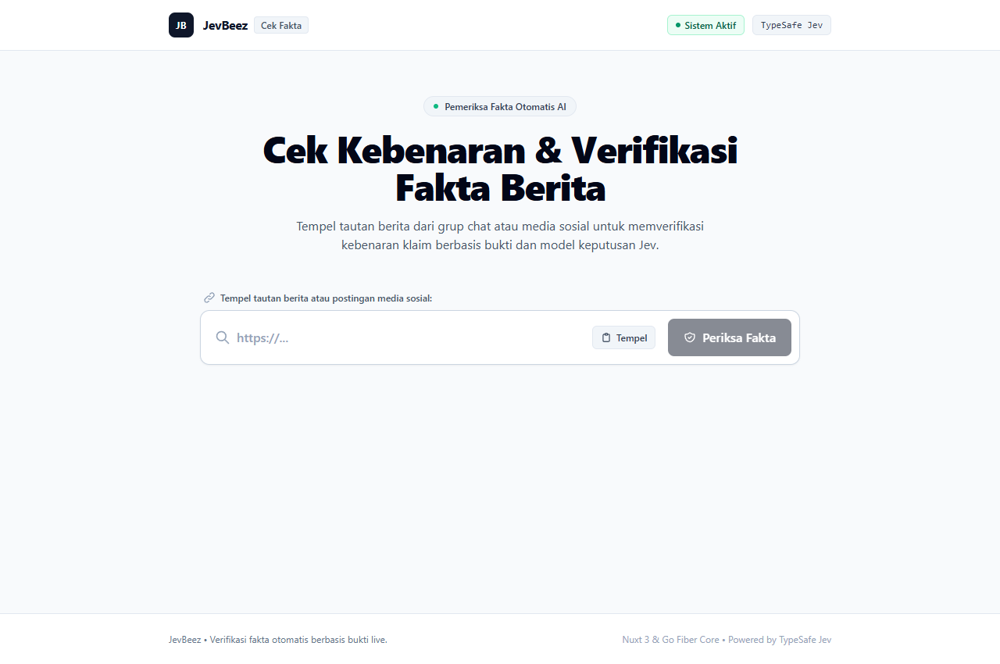

<div align="center">

# 🛡️ JevBeez

**Automated Evidence-Grounded Fact-Checking & Cyber Threat Detection Engine**

*Combatting digital disinformation, hoax narratives, phishing, and malware threats using calibrated System One probabilistic decision models (TypeSafe Jev) and real-time empirical web evidence grounding.*

[](https://golang.org)
[](https://nuxt.com)
[](https://vuejs.org)
[](https://tailwindcss.com)
[](https://redis.io)
[](https://www.docker.com)
[](LICENSE)

</div>

---

## 📸 User Interface

### 1. Fact-Check & Threat Intelligence Workbench
Modern editorial aesthetic featuring distraction-free, high-legibility typography (*anti-slop*) optimized for swift URL input and real-time feedback:



### 2. Analysis Dossier & Multi-Source Evidence Grounding
Displays transparent verification verdicts, calibrated confidence scores, probabilistic decision vectors, and primary cited web sources:


---

## 🌟 Overview

The proliferation of online disinformation, fake news, deceptive scams, and credential-harvesting phishing campaigns often spreads faster than manual debunking can keep up. Furthermore, standard Large Language Models (LLMs) frequently suffer from **hallucinations**, presenting fabricated statements with false confidence.

**JevBeez** provides a robust, enterprise-grade fact-checking and cyber threat mitigation platform built on a defense-in-depth hybrid architecture:
1. **Multi-Platform Scraper & Content Extractor**: Securely parses article claims and social media URLs (Twitter/X, TikTok, YouTube, Instagram, Threads, Facebook) using SSRF-safe scrapers and OEMBED protocols.
2. **Safe Shortener Resolver**: Unrolls obfuscated redirect chains (`s.id`, `bit.ly`, `tinyurl.com`, `link.id`, etc.) via lightweight HTTP header hops without downloading untrusted payloads.
3. **Zero-Contact Threat Heuristics (<20ms)**: Instantly detects brand impersonation, subdomain traps, homoglyphs, `@` credential tricks, raw IP hosts, high-risk TLDs, and executable dropper files (`.apk`, `.exe`) without contacting the malicious target server.
4. **Sandboxed Deep Dive Inspector**: On-demand isolated inspection streaming a maximum of 100KB with strict 3-second timeouts to identify credential-theft forms (PIN, OTP, CVV, passwords) and external data exfiltration.
5. **Multi-Source Evidence Grounding**: Performs live internet fact-finding across authoritative news outlets and independent fact-checking databases via Tavily & Firecrawl.
6. **System One Decision Engine (TypeSafe Jev)**: Evaluates claim validity through mathematically calibrated probabilities rather than unconstrained generative text.

---

## ✨ Core Features

- 🔍 **Multi-Platform Content Extraction**: Universal single-input analyzer supporting news portals and major social media platforms.
- ⚖️ **Calibrated Probabilistic Decision Modeling (TypeSafe Jev)**: Generates 3 independent quantitative metrics:
  - `supported_by_evidence`: Probability that the claim is substantiated by credible web evidence.
  - `contradicted_by_evidence`: Probability that the claim is refuted by verified reporting.
  - `sensational_framing`: Degree of clickbait, emotive exaggeration, or sensationalist framing.
- 🎯 **Comprehensive Verdict Classifications**:
  - **Factual Verifications**:
    - `VALID`: Factually accurate and corroborated by authoritative sources.
    - `HOAX`: Debunked claim or proven falsehood.
    - `MISLEADING`: Out-of-context, unverified, or manipulated narrative.
    - `UNVERIFIED`: Insufficient empirical evidence to draw a definitive conclusion.
  - **Cyber Threat Verifications**:
    - `PHISHING`: Fake login portals or credential-harvesting websites.
    - `MALWARE`: Malicious executables or deceptive APK dropper links.
    - `SCAM`: Fraudulent schemes, fake lotteries, or impersonation campaigns.
- 🎣 **Zero-Contact Threat Detection Engine**:
  - Protects users immediately by terminating before contacting rogue servers when fatal anomalies are discovered.
  - Detects brand spoofing for major Indonesian and global financial institutions and tech platforms (BCA, Mandiri, BRI, BNI, DANA, OVO, Shopee, Tokopedia, Gojek, Grab, etc.).
- 🔗 **Safe Shortener Unroller**:
  - Traces up to 5 redirection hops with strict SSRF and loopback protection.
- 🧪 **Sandboxed Deep Dive Content Audit**:
  - Users can optionally trigger deep content inspection to verify `<form>` input targets and Telegram bot exfiltration webhooks in a constrained sandbox.
- 📱 **Anti-Slop Editorial Design**:
  - Restful, professional user experience with clean typography, clear visual hierarchy, and full bilingual support (Indonesian & English).
- 🚀 **1-Click WhatsApp Debunk Broadcast**:
  - Pre-formatted warning templates ready to share directly to family and community chat groups in one click.
- ⚡ **Ultra-Fast Redis Caching**:
  - Key-value caching with configurable TTLs for sub-millisecond responses on repeated queries.
- 🛡️ **Enterprise Security & Rate Limiting**:
  - 15-second per-IP cooldown with RFC-compliant `429 Too Many Requests` and `Retry-After` headers.
  - Automated 24-hour malicious IP blocking for suspicious injection or abuse attempts.
  - Strict SSRF prevention blocking RFC 1918 private subnets, loopback (`127.0.0.0/8`), link-local (`169.254.0.0/16`), and internal DNS rebinding.

---

## 🏛️ System Architecture

```
                                  +-----------------------+
                                  |     Client / User     |
                                  |   (Browser / Mobile)  |
                                  +-----------+-----------+
                                              |
                                              | HTTPS
                                              v
                              +-------------------------------+
                              |    Nuxt 4 Frontend (SSR)      |
                              |   (Vue 3, Tailwind, Vite)     |
                              +---------------+---------------+
                                              |
                                              | Internal Proxy / Network
                                              v
                              +-------------------------------+
                              |      Go Fiber API Service     |
                              |   (Core Engine, Port 8080)    |
                              +---------------+---------------+
                                  |           |           |
            +---------------------+           |           +---------------------+
            | Redis Cache                     |                                 |
            v (Key-Value TTL)                 v (Live Grounding)                v (Probabilistic Evaluation)
   +-----------------+            +------------------------+            +-----------------------+
   |   Redis Store   |            | Search & Scraping Core |            |   TypeSafe Jev AI     |
   |   (Port 6379)   |            |  - Tavily Search API   |            | System One Evaluator  |
   +-----------------+            |  - Firecrawl Engine    |            +-----------------------+
                                  |  - SSRF Safe Scraper   |
                                  |  - Heuristic Engine    |
                                  |  - Shortener Resolver  |
                                  +------------------------+
```

---

## 🛠️ Tech Stack

| Layer | Component / Library | Purpose |
|---|---|---|
| **Frontend** | Nuxt 4 (Vue 3, TypeScript) | Server-Side Rendering (SSR), high performance & responsive UI |
| **Styling** | Tailwind CSS v3 | Editorial typography and adaptive threat banner system |
| **Backend Core** | Go 1.23, Fiber v2 | High-throughput, memory-efficient micro-service architecture |
| **Decision Model** | TypeSafe Jev AI | Non-hallucinatory System One calibrated probabilistic evaluation |
| **Search & Evidence** | Tavily Search & Firecrawl | Primary source discovery and live multi-source web extraction |
| **Heuristics & Sandbox**| Go standard net/http & x/net/html | Zero-contact heuristic analysis & 100KB sandboxed form audit |
| **Caching Layer** | Redis 7 Alpine | Key-value cache storage with password protection & rate limiters |
| **Containerization** | Docker & Docker Compose | Multi-container reproducible deployment |

---

## 🚀 Getting Started

### Prerequisites
- [Docker](https://www.docker.com/) & Docker Compose (v2.x or newer)
- Or for local development without Docker:
  - [Node.js](https://nodejs.org/) (>= 22.x) & [Bun](https://bun.sh/)
  - [Go](https://golang.org/) (>= 1.23)
  - [Redis Server](https://redis.io/) (>= 7.x)

### 1. Clone Repository
```bash
git clone https://github.com/Scr34m1nG/JevBeez.git
cd JevBeez
```

### 2. Configure Environment Variables
Copy the configuration template and fill in the required API keys:
```bash
cp .env.example .env
```

Set the values in your `.env` file:
```env
PORT=8080
CORS_ORIGIN=*
REDIS_ADDR=redis:6379
REDIS_PASSWORD=

# External Service API Keys
TYPESAFE_API_KEY=your_typesafe_api_key_here
TAVILY_API_KEY=your_tavily_api_key_here
FIRECRAWL_API_KEY=your_firecrawl_api_key_here

API_INTERNAL_URL=http://api:8080
```

> **Security Note:** Never commit your production `.env` file or expose private API credentials to a public repository.

---

### 3. Run with Docker Compose (Recommended)

Start the entire system with one command:
```bash
docker compose up --build -d
```

Services will be accessible at:
- **Web Interface:** `http://localhost:3000`
- **Backend API:** `http://localhost:8080`
- **Redis Cache:** `127.0.0.1:6379`

To stop the services:
```bash
docker compose down
```

---

### 4. Local Development (Without Docker)

**Step A: Start Redis**
```bash
docker run -d --name jevbeez-redis -p 6379:6379 redis:7-alpine
```

**Step B: Start Backend API (Go)**
```bash
cd apps/api
go run cmd/server/main.go
```

**Step C: Start Frontend (Nuxt)**
```bash
cd apps/web
bun install
bun run dev
```
Open your browser at `http://localhost:3000`.

---

## 📡 API Documentation

### 1. `GET /health`
Verifies backend service operational health.

**Response (`200 OK`):**
```json
{
  "service": "jevbeez-api",
  "status": "ok"
}
```

---

### 2. `POST /api/v1/analyze`
Analyzes a URL for factual verification or cyber threats (phishing, scam, malware).

**Request Headers:**
- `Content-Type: application/json`

**Request Body:**
```json
{
  "url": "https://example.com/article-or-link",
  "deep_dive": false
}
```

| Parameter | Type | Required | Description |
|---|---|---|---|
| `url` | `string` | Yes | Target web or social media URL to analyze |
| `deep_dive` | `boolean` | No | When `true`, executes sandboxed form & DOM inspection (Default: `false`) |

#### Example Response: Standard Fact-Checking (`200 OK`)
```json
{
  "verdict": "VALID",
  "confidence": 88,
  "judgments": {
    "supported_by_evidence": 0.88,
    "contradicted_by_evidence": 0.05,
    "sensational_framing": 0.08
  },
  "article_title": "Verified News Headline",
  "article_url": "https://example.com/article-or-link",
  "source_domain": "example.com",
  "summary": "The claim is substantiated by multiple credible news reports and factual corroboration.",
  "red_flags": [],
  "evidences": [
    {
      "source": "reuters.com",
      "title": "Official Report on the Event",
      "snippet": "Corroborating statement from official representatives...",
      "url": "https://www.reuters.com/article/..."
    }
  ],
  "is_cached": false,
  "is_social": false,
  "platform": "",
  "is_threat": false
}
```

#### Example Response: Threat / Phishing Detection (`200 OK`)
```json
{
  "verdict": "PHISHING",
  "confidence": 92,
  "judgments": {
    "supported_by_evidence": 0,
    "contradicted_by_evidence": 0,
    "sensational_framing": 0
  },
  "article_title": "Security Threat Warning: Phishing / Fake Site",
  "article_url": "https://bca.co.id.login-promo.xyz/auth",
  "source_domain": "login-promo.xyz",
  "summary": "This link exhibits high-risk cyber threat characteristics matching phishing campaigns. Do not enter credentials or OTP codes.",
  "red_flags": [
    "High-risk top level domain (.xyz) frequently associated with malicious campaigns",
    "Subdomain spoofing impersonating official brand 'bca'"
  ],
  "evidences": [],
  "is_cached": false,
  "is_threat": true,
  "threat_type": "PHISHING",
  "threat_reasons": [
    "Subdomain spoofing targeting brand 'bca'",
    "High-risk top level domain (.xyz)"
  ],
  "target_brand": "bca",
  "resolved_url": "https://bca.co.id.login-promo.xyz/auth",
  "form_threats": [],
  "is_deep_dive": false
}
```

**HTTP Status Codes:**
- `200 OK`: Successful analysis completed.
- `400 Bad Request`: Malformed JSON or invalid URL scheme.
- `422 Unprocessable Entity`: Unable to extract valid textual content.
- `429 Too Many Requests`: Rate limit or cooldown active (`Retry-After` header included).
- `500 Internal Server Error`: Server-side processing failure.

---

## 🔒 Security & Privacy Policy

JevBeez is engineered with strict **Zero-Risk** and **Privacy-by-Design** principles:
1. **SSRF (Server-Side Request Forgery) Mitigation**:
   - Strict protocol enforcement (only `http` and `https` permitted).
   - Pre-flight DNS resolution before fetching to block all RFC 1918 private IP subnets, loopback (`127.0.0.0/8`), link-local (`169.254.0.0/16`), and internal Docker virtual networks.
2. **Zero-Contact Threat Pipeline**:
   - Fatal structural anomalies terminate execution before contacting malicious servers, protecting internal infrastructure from client-side exploit payloads.
3. **Data Privacy**:
   - **No Personally Identifiable Information (PII) is recorded or stored**.
   - Analysis evaluates public web metadata, claims, and verified news sources only.
4. **Hardened HTTP Headers**:
   - Strict Content Security Policy (CSP), `X-Content-Type-Options: nosniff`, `X-Frame-Options: DENY`, `Referrer-Policy: strict-origin-when-cross-origin`, and HSTS headers.
5. **Zero Secret Exposure**:
   - API tokens and Redis credentials remain isolated on server environments and are never exposed to client bundles.

---

## 🧪 Automated Testing

**Run Backend Unit & Integration Tests (Go):**
```bash
cd apps/api
go test -v ./...
```

**Run Frontend Unit Tests (Bun / Vitest):**
```bash
cd apps/web
bun test
```

**Verify Production Frontend Build:**
```bash
cd apps/web
bun run build
```

---

## 🤝 Contribution & GitFlow Standards

The project strictly follows **GitFlow** and **Conventional Commits**:
- `main`: Production-ready release branch only.
- `develop`: Primary integration branch for day-to-day development.
- `feature/<name>`: New features branched from `develop` and merged back after full test verification.
- `bug-fix/<name>`: Bug fixes branched from and merged back to `develop`.
- `hotfix/<name>`: Emergency production fixes branched from `main`.

Please ensure all tests (`go test ./...` and `bun test`) pass before opening a Pull Request.

---

## 📄 License

Distributed under the **MIT License**. See [LICENSE](LICENSE) for details.

---

<div align="center">
  <sub>Built for a safer, cleaner, and empirically verified digital ecosystem.</sub>
</div>
